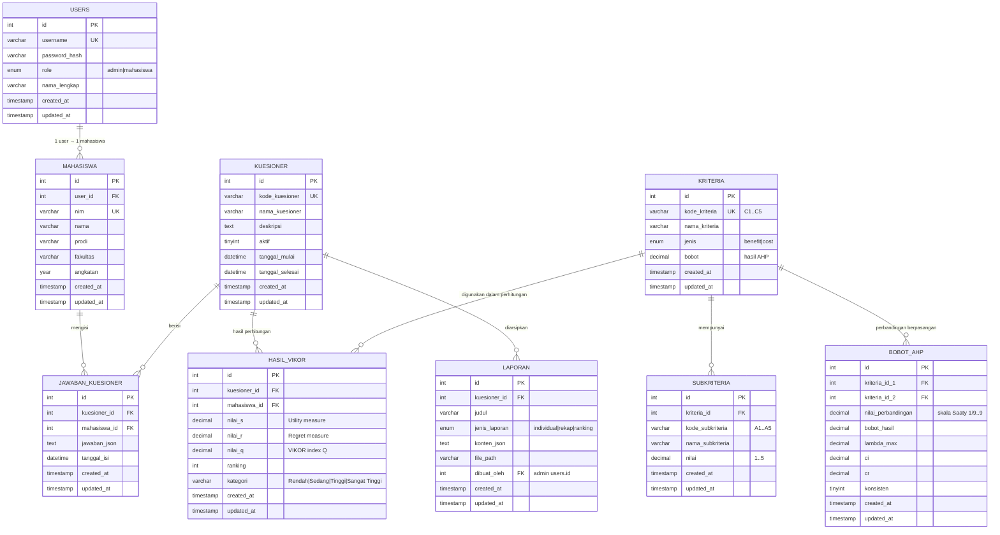

# ERD — Sistem Identifikasi Tingkat Kecanduan Media Sosial (AHP + VIKOR)
**Ilmu Komputer Universitas Pattimura**  
MySQL 8.x | `rusnian_db` | utf8mb4_unicode_ci

---

## Ringkasan Tabel (9)

| Tabel | Deskripsi | Kolom PK | FK | Index Khusus |
|---|---|---|---|---|
| `users` | Login admin & mahasiswa | `id` | — | `uk_username`, `idx_role` |
| `mahasiswa` | Profil mahasiswa | `id` | `user_id → users.id` | `uk_nim`, `idx_user_id`, `idx_nama` |
| `kuesioner` | Periode/paket kuesioner | `id` | — | `uk_kode_kuesioner`, `idx_aktif` |
| `jawaban_kuesioner` | Jawaban per mahasiswa | `id` | `kuesioner_id → kuesioner.id`, `mahasiswa_id → mahasiswa.id` | `uk_kuesioner_mahasiswa` |
| `kriteria` | C1–C5 (AHP/VIKOR) | `id` | — | `uk_kode_kriteria` |
| `subkriteria` | A1–A5 per kriteria | `id` | `kriteria_id → kriteria.id` | `uk_kriteria_sub`, `idx_kriteria` |
| `bobot_ahp` | Matriks Saaty 5×5 + CI/CR | `id` | `kriteria_id_1 → kriteria.id`, `kriteria_id_2 → kriteria.id` | `uk_pasangan` |
| `hasil_vikor` | S, R, Q + ranking per mhs | `id` | `kuesioner_id → kuesioner.id`, `mahasiswa_id → mahasiswa.id` | `uk_kuesioner_mahasiswa_vikor`, `idx_ranking`, `idx_q` |
| `laporan` | Arsip cetak | `id` | `kuesioner_id → kuesioner.id`, `dibuat_oleh → users.id` | `idx_kuesioner_laporan`, `idx_jenis` |

---

## Mermaid Diagram



---

## Flow Data AHP → VIKOR

1. **Input AHP** → Admin isi 10 pasangan perbandingan Saaty di `bobot_ahp`
2. **Service AHP** → `computeAHP()` → bobot kriteria `C1..C5` + CR < 0.1 → simpan `kriteria.bobot`
3. **Input Kuesioner** → Mahasiswa isi `jawaban_kuesioner` (25 item A1–A5 skala 1–5)
4. **Service VIKOR** → `computeVIKOR()` dengan bobot dari AHP + jawaban → S, R, Q, ranking
5. **Kategori** → `Q ≤ 0.25: Rendah`, `0.25<Q≤0.5: Sedang`, `0.5<Q≤0.75: Tinggi`, `Q>0.75: Sangat Tinggi`
6. **Simpan** → `hasil_vikor` + `laporan` (HTML/JSON snapshot)

---

## Default Data

| Tabel | Jumlah | Sumber |
|---|---|---|
| `kriteria` | 5 | C1 Durasi, C2 Frekuensi, C3 Ketergantungan, C4 Gangguan Akademik, C5 FoMO |
| `subkriteria` | 25 | 5 × 5 (A1–A5 per kriteria) |
| `users` | 2 demo | admin1 / 202106070001 |
| `mahasiswa` | 2 demo | Budi (2021), Ani (2022) |

---

## Cara Jalankan

```bash
# 1) Buat database & tabel
mysql -u root -p < db/001_initial_schema.sql

# 2) Seed data
mysql -u root -p < db/seed.sql
```

---

*Dibuat otomatis oleh Cerberus — Project Sistem Rusnian AHP+VIKOR*